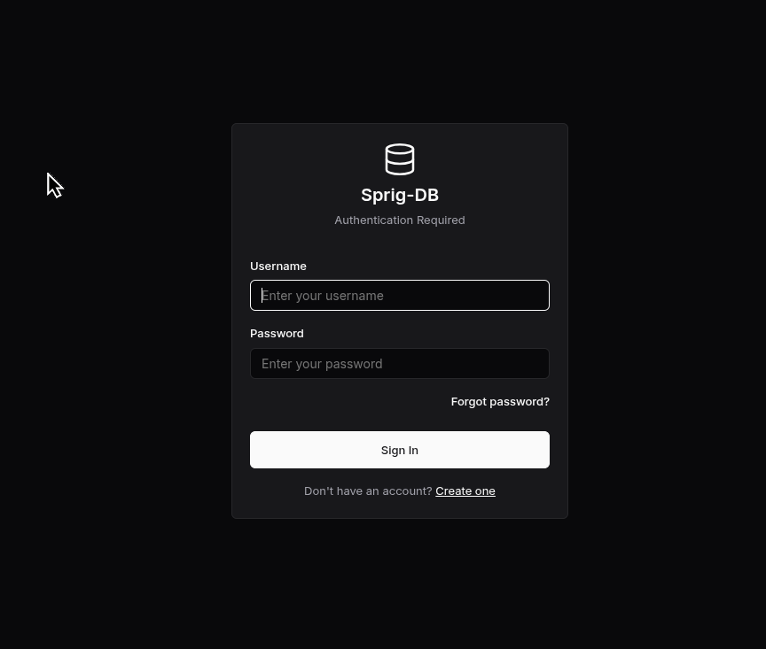
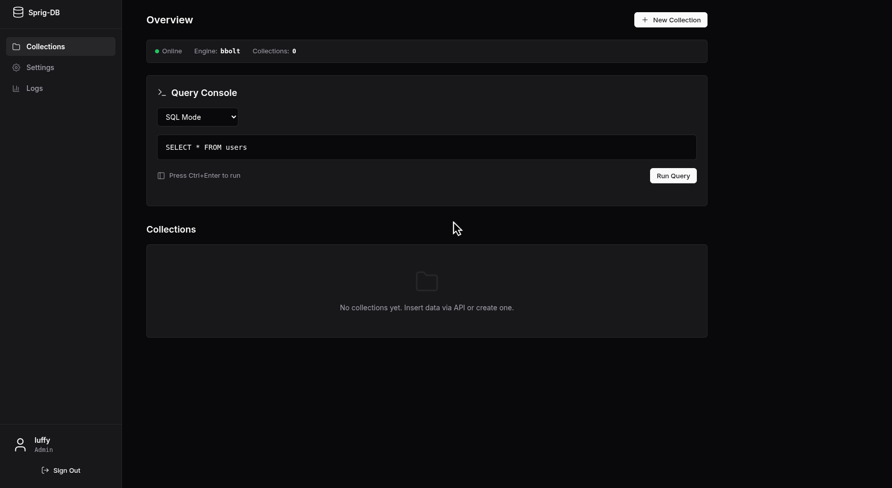
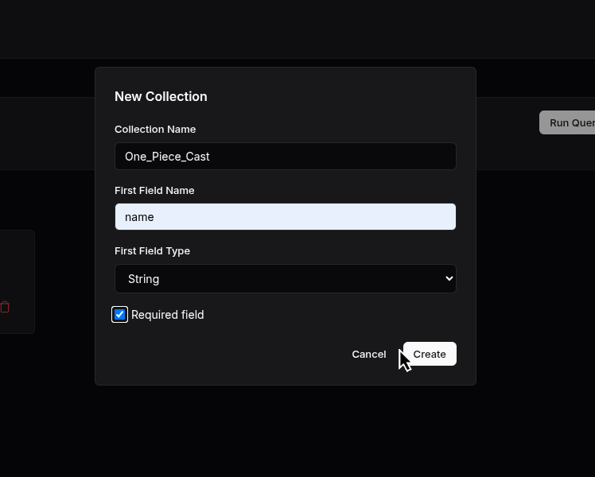
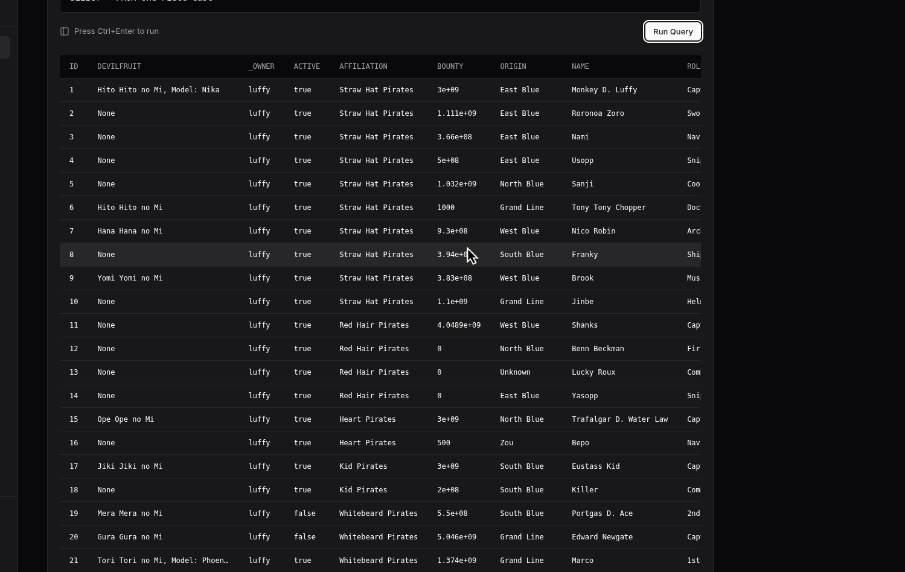
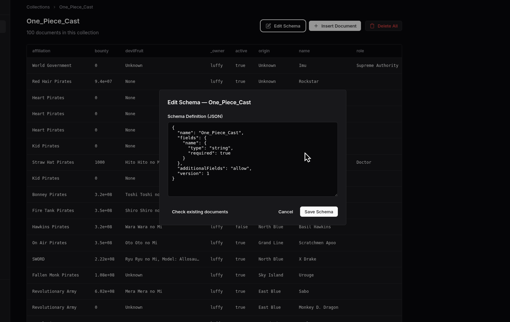
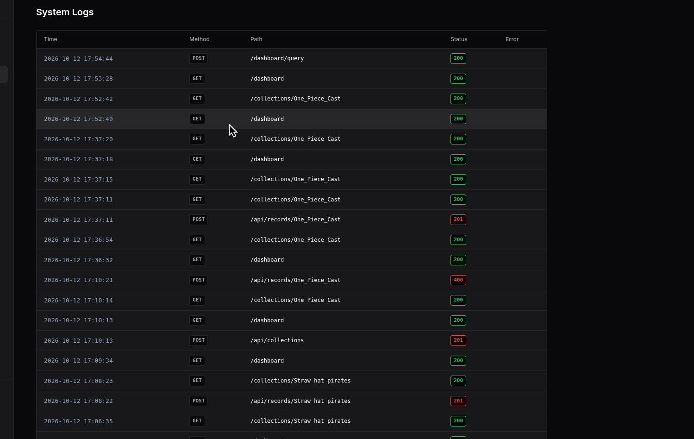

<div align="center">
  <h1>Sprig-DB</h1>
  <p><strong>Ultra-lightweight, embedded key-value document database with schema enforcement, SQL querying, and a glassmorphic dashboard</strong></p>
  <p><a href="https://sprig-db.onrender.com"><strong>🚀 Live Demo</strong></a></p>
  <p>Built on top of <b>bbolt</b>, Sprig-DB provides abstraction layers for collections, schemas, indexing, SQL-like querying, and multi-tenant security with a zero-configuration persistence model and a built-in REST API.</p>
</div>

---

## Features

- **Embedded ACID Engine**: Powered by `bbolt`, providing resilient, high-speed, and ACID-compliant key-value storage.
- **Dynamic Schema Validation**:
  - Typed fields: `string`, `number`, `integer`, `boolean`, `array`, `object`.
  - Rich constraints: `required`, `minimum`, `maximum`, `minLength`, `maxLength`, `pattern`, `enum`, and nested `items` schemas.
  - Flexible or strict modes via `additionalFields` (`"allow"` or `"reject"`).
  - Dual schema format support: Sprig's native schema format and standard **JSON-Schema** (draft-04 subset).
  - **Schema Dry-Run & Check**: Pre-flight verification endpoint (`/schema/check`) tests proposed schemas against existing collection data before applying changes.
- **Dual Query Console (SQL & NoSQL)**:
  - Interactive SQL mode supporting `SELECT`, `WHERE`, `ORDER BY`, `LIMIT`, and `OFFSET`.
  - Column projections, arithmetic comparisons (`=`, `!=`, `>`, `<`, `>=`, `<=`), logical filters (`AND`, `OR`), and substring matches (`LIKE`).
  - Native NoSQL key-value equality query interface.
- **Enterprise Security & Multi-Tenancy**:
  - User registration and login with bcrypt password hashing and CAPTCHA challenge protection.
  - JWT token and HTTP-only cookie authentication.
  - Strict tenant isolation: collections, schemas, queries, and logs are partitioned per user (`_owner`).
- **Glassmorphic Admin Dashboard**:
  - Modern dark-mode interface built with **Echo** and **HTMX**.
  - Collection browser with paginated tabular view (50 items/page) and dynamic column detection.
  - Interactive modal dialogs for schema editing, dry-run schema validation, and document insertion.
- **Atomic Bulk Ingestion**:
  - Ingest single documents or batches of up to 100 documents atomically with complete schema validation.
- **Live Audit & Request Logging**:
  - Tenant-scoped audit logs tracking timestamp, HTTP method, route path, status code, and error messages for immediate troubleshooting.
- **High-Performance Benchmarks**:
  - Built-in multi-threaded HTTP load tester and endurance test suites.

---

##Screenshots & UI Tour

Below is a walkthrough of the Sprig-DB web interface and tooling:

### 1. Authentication & Security

Secure login and registration with interactive CAPTCHA verification and JWT session management.



### 2. Admin Dashboard Overview

Real-time tenant statistics, collection summaries, and quick navigation across datasets.



### 3. Collection Browser & Data Viewer

Explore collection records with auto-detected dynamic columns, record counts, and pagination controls.


### 4. Data Ingestion & Insertion

Insert single documents or batches of JSON objects with immediate schema validation.



### 5. Interactive SQL Query Console

Execute SQL queries with column projection, multi-field filtering, sorting, and pagination directly against embedded collections.



### 6. Schema Management & Dry-Run Validation

Define field types, constraints, and configure strict vs. permissive modes (`additionalFields`). Perform live dry-run checks against existing records before committing changes.



### 7. Request Logs & Troubleshooting

Tenant-scoped request logs capturing execution timestamps, HTTP methods, paths, status codes, and error traces.



---

## 🏗️ Architecture

```text
.
├── api/                    # Production web endpoints, auth, schema engine, and SQL parser
│   ├── api.go              # REST API handlers (records, collections, schemas)
│   ├── auth.go             # JWT authentication, captcha, password recovery
│   ├── filter_map.go       # Query filter parsing
│   ├── schema.go           # Schema store, types, and document validation
│   ├── schema_parser.go    # JSON-Schema conversion & validation logic
│   ├── sql_query.go        # SQL parser & query execution engine
│   └── web.go              # HTMX dashboard and web view controllers
├── cmd/                    # Application entrypoints
│   ├── main.go             # Primary HTTP API and web server
│   ├── loadtest/           # High-concurrency benchmark script
│   └── populate/           # Database population utilities
├── sprig/                  # Core Database Engine
│   ├── db.go               # BoltDB wrapper, database life cycle
│   ├── filter.go           # Record filtering, pagination, secondary index management
│   ├── models.go           # Core types (Sprig, Map, QueryResult)
│   └── log.go              # Structured logging
├── templates/              # HTMX templates for the glassmorphic UI
│   ├── login.html          # Authentication view (Login / Register / Captcha)
│   ├── dashboard.html      # Main tenant console
│   ├── collection.html     # Paginated collection viewer & schema editor modal
│   ├── query_result.html   # Query output table partial
│   ├── logs.html           # Request audit log view
│   └── settings.html       # Tenant settings and data reset
├── static/                 # Stylesheets and frontend assets
├── Makefile                # Build, test, and formatting automation toolchain
├── go.mod                  # Go module definition
└── readme.md               # Documentation
```

---

## 🚀 Quick Start

### 1. Build & Run the Server
Sprig-DB includes a `Makefile` to streamline common tasks:

```bash
# Build the binary
make build

# Build and run the HTTP API Server (listens on :7777 by default)
make run
```

Access the dashboard in your browser at: **`http://localhost:7777`** (or try the [Live Demo](https://sprig-db.onrender.com)).

### 2. Run Tests & Benchmarks
Run core engine unit tests, schema parser tests, and storage endurance benchmarks:
```bash
make test
```

### 3. Run Throughput Load Tester
Run a concurrent multithreaded HTTP benchmark against the running server:
```bash
make loadtest
```

---

## 📐 Schema Enforcement

Sprig-DB ensures schema integrity while maintaining document-store flexibility. Schemas can be authored in native format or standard JSON-Schema.

### Schema Properties

| Property | Description | Example |
| :--- | :--- | :--- |
| `type` | Field data type (`string`, `number`, `integer`, `boolean`, `array`, `object`) | `"string"` |
| `required` | Whether the field is mandatory on insert | `true` |
| `minimum` / `maximum` | Numeric range boundaries | `minimum: 0`, `maximum: 150` |
| `minLength` / `maxLength` | String length constraints | `minLength: 3`, `maxLength: 50` |
| `pattern` | Regular expression for string validation | `"^[a-zA-Z0-9_-]+$"` |
| `enum` | Allowed enumerated values | `["admin", "editor", "viewer"]` |
| `items` | Nested schema for array elements | `{"type": "string"}` |
| `additionalFields` | Unknown field policy: `"allow"` (flexible) or `"reject"` (strict) | `"reject"` |

### Example Schema (JSON-Schema Format)

```json
{
  "name": "employees",
  "additionalFields": "reject",
  "json_schema": {
    "type": "object",
    "required": ["name", "email", "age", "role"],
    "properties": {
      "name": { "type": "string", "minLength": 2 },
      "email": { "type": "string", "pattern": "^[^@]+@[^@]+\\.[^@]+$" },
      "age": { "type": "integer", "minimum": 18, "maximum": 70 },
      "role": { "type": "string", "enum": ["developer", "designer", "manager"] },
      "skills": {
        "type": "array",
        "items": { "type": "string" }
      }
    }
  }
}
```

---

## 🔍 Query Modes

Sprig-DB provides two query interfaces:

### 1. SQL Query Mode (Dashboard Console)
Execute structured queries with full filtering, column projection, and ordering:

```sql
SELECT name, email, age FROM employees WHERE age >= 25 AND role = 'developer' ORDER BY age DESC LIMIT 20 OFFSET 0
```

Supported SQL syntax:
- Projection: `SELECT *` or `SELECT field1, field2, ...`
- Conditions: `=`, `!=`, `>`, `<`, `>=`, `<=`, `LIKE '%val%'`, `AND`, `OR`
- Sorting: `ORDER BY field ASC|DESC`
- Pagination: `LIMIT n OFFSET n`

### 2. NoSQL Filtering (REST API)
Filter collection documents via URL query parameters using the format `?{FilterType}.{field}={value}`:

```bash
# Equality filter
curl -H "Authorization: Bearer $TOKEN" \
  "http://localhost:7777/api/records/employees?eq.role=developer"
```

---

## HTTP REST API Reference

All protected API endpoints require JWT authentication. Obtain a token via `POST /auth/login` and provide it in the `Authorization: Bearer <token>` header or as a session cookie.

### Authentication Endpoints

| Method | Endpoint | Description |
| :--- | :--- | :--- |
| `GET` | `/auth/captcha` | Generates a new CAPTCHA challenge |
| `POST` | `/auth/register` | Registers a new user account |
| `POST` | `/auth/login` | Authenticates user and returns JWT token |
| `POST` | `/auth/forgot-password` | Requests password recovery |
| `POST` | `/auth/reset-password` | Resets account password |

### Collection & Schema Endpoints

| Method | Endpoint | Description |
| :--- | :--- | :--- |
| `GET` | `/api/collections` | List all collections belonging to the current tenant |
| `POST` | `/api/collections` | Create a collection with schema definition |
| `GET` | `/api/collections/:name/schema` | Retrieve the active schema for a collection |
| `PUT` | `/api/collections/:name/schema` | Update collection schema (increments schema version) |
| `POST` | `/api/collections/:name/schema/check` | Dry-run validation of a schema against existing documents |
| `DELETE` | `/api/collections/:name` | Delete a collection and its schema (tenant-scoped) |

### Record Endpoints

| Method | Endpoint | Description |
| :--- | :--- | :--- |
| `POST` | `/api/records/:name` | Insert a single document or a batch array (up to 100) |
| `GET` | `/api/records/:name` | Query documents with filters and pagination |
| `PUT` | `/api/records/:name` | Update records matching filter criteria |
| `DELETE` | `/api/records/:name` | Delete records matching filter criteria |
| `POST` | `/api/settings/reset` | Delete all collections, records, and logs for the tenant |

### API Usage Examples

#### 1. Create Collection with Schema
```bash
curl -X POST http://localhost:7777/api/collections \
  -H "Authorization: Bearer $TOKEN" \
  -H "Content-Type: application/json" \
  -d '{
    "name": "products",
    "additionalFields": "reject",
    "fields": {
      "title": { "type": "string", "required": true, "minLength": 2 },
      "price": { "type": "number", "required": true, "minimum": 0 },
      "stock": { "type": "integer", "required": true, "minimum": 0 }
    }
  }'
```

#### 2. Insert Single Document
```bash
curl -X POST http://localhost:7777/api/records/products \
  -H "Authorization: Bearer $TOKEN" \
  -H "Content-Type: application/json" \
  -d '{"title": "Mechanical Keyboard", "price": 99.99, "stock": 50}'

# Response: {"id": 1}
```

#### 3. Atomic Bulk Insert (Batch Array)
```bash
curl -X POST http://localhost:7777/api/records/products \
  -H "Authorization: Bearer $TOKEN" \
  -H "Content-Type: application/json" \
  -d '[
    {"title": "Wireless Mouse", "price": 49.99, "stock": 100},
    {"title": "USB-C Hub", "price": 29.99, "stock": 75}
  ]'

# Response: {"ids": [2, 3]}
```

#### 4. Pre-flight Schema Check (Dry-Run)
```bash
curl -X POST http://localhost:7777/api/collections/products/schema/check \
  -H "Authorization: Bearer $TOKEN" \
  -H "Content-Type: application/json" \
  -d '{
    "additionalFields": "reject",
    "fields": {
      "title": { "type": "string", "required": true },
      "price": { "type": "number", "required": true, "minimum": 10 },
      "stock": { "type": "integer", "required": true }
    }
  }'

# Response: {"valid": true, "total_records": 3, "invalid_records": 0}
```

---

##  Embedding Sprig Programmatically

You can embed Sprig directly into your Go applications as a lightweight embedded key-value store:

```go
package main

import (
    "fmt"
    "github.com/Debjit28/sprig-db/sprig"
)

func main() {
    // Initialize DB instance
    db, err := sprig.New()
    if err != nil {
        panic(err)
    }
    defer db.Close()

    // Insert a document
    id, err := db.Coll("users").Insert(sprig.Map{
        "name": "Alice",
        "role": "admin",
    })
    if err != nil {
        panic(err)
    }
    fmt.Printf("Inserted record ID: %d\n", id)

    // Query documents
    result, err := db.Coll("users").Eq(sprig.Map{"name": "Alice"}).Find()
    if err != nil {
        panic(err)
    }
    fmt.Printf("Found %d matching records\n", result.Total)
}
```

---

## Current Scope & Limitations

Sprig-DB is designed as a fast, embedded educational database and lightweight micro-service store:
- **Foreign Keys**: As a document store, relational integrity and joins are handled at the application level (see `examples/relational_embedding/main.go`).
- **Distributed Consensus**: Sprig-DB is a single-node embedded storage engine. It does not provide multi-node clustering or Raft replication out-of-the-box.
- **Cross-Collection Transactions**: Multi-document operations within a single collection are atomic; cross-collection transactions are not currently grouped into a single unit.

---

## Acknowledgments

This project draws inspiration from learning resources in the Go and database systems communities:
- Architectural patterns inspired by [anthdm/hopper](https://github.com/anthdm/hopper).
- Database internals and storage concepts guided by Alex Petrov's *Database Internals*.

---

## 📜 License

This project is licensed under the [MIT License](LICENSE).

### Note on Contributions
This repository is primarily a personal learning and portfolio project. While pull requests are not currently accepted, feedback, issue reports, and suggestions are always welcome!
- ⭐ Star the repository if you find it helpful.
- 🐛 Open an issue if you discover a bug.
- 💡 Share suggestions in GitHub Discussions or Issues.
